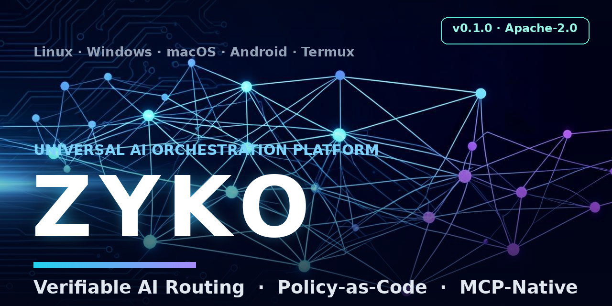

<div dir="rtl">

<div align="center">



[](https://github.com/tibatechapp-ship-it/zyko/actions/workflows/ci.yml)
[](CHANGELOG.md)
[](.github/workflows/ci.yml)
[](pyproject.toml)
[](.github/workflows/ci.yml)
[](LICENSE)

[الابتكارات](docs/INNOVATION.md) · [سجل الإصدارات](docs/HISTORY.md) · [الموقع التعريفي](https://tibatechapp-ship-it.github.io/zyko/) · [المناقشات](https://github.com/tibatechapp-ship-it/zyko/discussions)

</div>

# ZYKO — محرك البرمجة العربي الحتمي

> توليد ← مراجعة ← إصلاح ← حارس — من بوابة واحدة، بإيصالات توجيه قابلة للتحقق، وعلى أي منصة.

النسخة **0.38.0** · اعتماديتان فقط (`httpx` و`PyYAML`) · بايثون 3.11 – 3.14

---

<!-- English entry point — Arabic-first stays the product; this block is the discovery bridge. -->
<div dir="ltr">

**ZYKO in one minute (English):** a deterministic, Arabic-first coding engine + AI
orchestration platform. Generate → review (38 AST rules + taint analysis) → fix →
verify — from one command, with **offline-verifiable signed receipts** (`zyko verify`
re-computes any routing decision; byte-level determinism is a tested contract, not a
slogan). Works with **zero API keys** (deterministic brain), or a local model via
Ollama, or any OpenAI-compatible cloud brain behind the same gates. Policy-as-code,
MCP client+server, multi-user gateway, RAG essentials, agent crews, 2 mandatory
dependencies, and first-class Android/Termux support. 2778 tests passing on
Linux·macOS·Windows × Python 3.11–3.14. See [CHANGELOG](CHANGELOG.md) ·
[Architecture](docs/ARCHITECTURE.md) · [Innovations](docs/INNOVATION.md).

</div>

---

## ما يميز ZYKO

| الركيزة | ماذا تعني عمليًا |
|:---|:---|
| **حتمية بالبايت** | نفس المدخل = نفس المخرج (SHA-256). لا طوابع زمنية ولا عشوائية — حتى تقارير HTML وخط الأساس مُختبران بمساواة بايتات. |
| **إيصالات قابلة للتحقق** | `zyko verify` يعيد حساب أي قرار توجيه (جودة/تكلفة/زمن) **دون اتصال** — وقد اكتشف فعلًا خطأً حقيقيًا في الموجِّه الذي وُجد ليحميه. |
| **محرك برمجة عربي** | توليد حتمي من وصف عربي واحد، مراجعة بـ38 قاعدة AST + تحليل تلوث بيانات، وإصلاح مُتحقَّق بإعادة التحليل قبل القبول. |
| **حارس ما قبل الكتابة** | المحرّس: أي اقتراح من أي نموذج يمر PII ← RTL ← بنية قبل كتابة بايت واحد، والقرار (ALLOW/DENY/REVIEW) موقَّع ببصمة sha256. |
| **عقول خلف البوابات نفسها** | عقل مخطط حتمي، أو نموذج محلي عبر Ollama، أو منافسة عقول (`BestOfBrain`) — الإيصال يروي القصة كاملة. |
| **محمي قانونيًا** | كل ابتكارات ZYKO منشورة كإثبات مسبق (Prior Art) مؤرَّخ في [docs/INNOVATION.md](docs/INNOVATION.md). |

---

## التثبيت

```bash
pip install git+https://github.com/tibatechapp-ship-it/zyko.git
```

أو من المصدر:

```bash
git clone https://github.com/tibatechapp-ship-it/zyko.git && cd zyko
pip install -e .
```

---

## جرّبه في دقيقة

```bash
# 1) توجيه قابل للتحقق — بلا شبكة وبلا مفاتيح
zyko ask 'مرحبا' --demo --receipt r.json && zyko verify r.json

# 2) الحلقة كاملة: توليد ← مراجعة ← إصلاح من وصف عربي واحد
zyko factory pipeline --description "قائمة مهام للفريق" --out ./مشروعي

# 3) بوابات المراحل الأربع (24 بوابة كمية) ولوحة تحكم HTML حتمية
zyko factory gates --html /tmp/لوحة.html

# 4) حارس الجودة عبر الزمن — بلا طوابع زمنية
zyko factory baseline update --src ./مشروعي
zyko factory baseline check --src ./مشروعي

# 5) ذكاء محلي خلف البوابات نفسها
zyko ai run --brain ollama --model <model> --goal "وصف عربي"

# 6) بايثون عربية: لغة ضاد المستقلة عبر حدود عملية منفصلة
zyko py hello.daad --run

# 7) نواة العقل المستقل: الحلقة الإدراكية الكاملة بذاكرة مشروع
#    (القلب يُكتشف تلقائيًا: مفاتيح البيئة أو Ollama تفعّل دماغًا حقيقيًا،
#     وغيابها يرجع الحتمي — والقرار موثّق في الإيصال)
zyko mind run "انشئ مشروع قائمة مهام مع واجهة سطر أوامر" -o ./جديد
zyko mind run "الهدف" -o ./جديد --brain deterministic   # تجاوز صريح
zyko mind run "الهدف" -o ./جديد --tools                 # أدوات معزولة: اختبارات حقيقية + سجل تدقيق
```

---

## شاهدها يعمل — على كود حقيقي

تشغيل موثّق على ملف واقعي من مكتبة [psf/requests](https://github.com/psf/requests): `src/requests/models.py` — **1184 سطراً** (التجربة الكاملة والمنهجية في [docs/REAL_WORLD_TEST.md](docs/REAL_WORLD_TEST.md)):

```text
$ zyko do "راجع src/requests/models.py" --dry-run
[INFO] المهمة: REVIEW — ثقة 0.70
الخطة (1 خطوة):
  1. [review] مراجعة حتمية بقواعد AST — بلا نموذج وبلا شبكة — args: {"path": "src/requests/models.py"}
[WARN] الوضع: تجريبي — لن يُكتب أي ملف (استخدم --write للتطبيق)
التنفيذ:
  ✓ [review] الدرجة 10 — مرفوض (guardian: ALLOW)
  chain_hash             d0e52368…f42485

real    0m0.828s
```

ما جرى في 0.83 ثانية بلا شبكة وبلا مفاتيح: تصنيف الهدف (REVIEW) ← استخراج المسار الحقيقي من النص العربي ← مراجعة AST وجدت **24 ملاحظة حقيقية** (1 عالية، 18 متوسطة، 5 منخفضة) ← درجة حتمية 10/100 وحكم «مرفوض» بمزايدة موثقة ← Guardian يسمح ← إيصال موقّع بـ `chain_hash` قابل للتحقق. ودماغ سحابي (Qwen/OpenAI-compatible) يعمل خلف البوابات نفسها: `zyko ai run --brain qwen --model <model> --goal "راجع وأصلح <ملف>"`.

---

## الأوامر الأساسية

| الأمر | الوظيفة |
|:---|:---|
| `zyko factory pipeline` | الحلقة كاملة بأمر واحد (`--description` + `--out`) |
| `zyko factory workspace` | المحرك على مشروع قائم (تجربة جافة افتراضيًا) |
| `zyko factory fix --path <p>` | إصلاح ملف أو مجلد مع تحقق AST |
| `zyko factory baseline update/check` | حارس الجودة عبر الزمن |
| `zyko factory gates --html <p>` | بوابات المراحل 3+4+5+6 ولوحة HTML حتمية |
| `zyko factory dashboard` | لوحة تحكم عربية (HTML + Markdown) موقعة ببصمة |
| `zyko factory map` | خريطة المصنع: الوحدات والعقود وأكواد الخروج |
| `zyko verify <receipt>` | تحقق دون اتصال من أي إيصال توجيه |
| `zyko gauntlet` | الفحص الكبير: 1000 برنامج حقيقي — ومع `--repeats`/`--review-sample` طبقة الشدّ (حتمية متكررة × سرعة × مراجعة ذاتية) |
| `zyko compare <ملف>` | المقارنة الحتمية: دقة التصنيف + سرعة + حتمية على هدفك، ومنافس اختياري بأمر تمرره أنت |
| `zyko do --brain ollama --model m` | العقل كاملاً مع تخطيط دماغ حقيقي خلف البوابات — والرجوع آمن للمخطط الحتمي عند أي فشل |
| `zyko py <file.daad>` | ترجمة/تنفيذ بايثون عربية (ضاد) |
| `zyko ai run` | جلسة ذكاء موثقة عبر البوابات (`planner` / `ollama` / `bestof`) |
| `zyko mind run "الهدف" -o مجلد` | **الحلقة الإدراكية الكاملة** (المرحلة A من MIND.md): إدراك ← تخطيط ← تنفيذ ← نقد ← انعكاس وإعادة محاولة ← ذاكرة — حلقة ذاتية التصحيح: حرّاس مخرجات على كل مرحلة، وملاحظة انعكاس عربية من كل فشل تعود مدخلًا للمحاولة التالية تحت ميزانية صارمة لكل مرحلة، وكلها موثقة بالإيصال وذاكرة مشروع دائمة في `.zyko/mind/`. القلب تلقائي (`--brain auto` الافتراضي): أول مفتاح سحابي في البيئة أو نقطة Ollama محلية تفعّل دماغًا حقيقيًا خلف البوابات، والغياب يرجع الحتمي — والقرار في الإيصال بلا أي قيمة مفتاح |
| `zyko mind run "الهدف" -o مجلد --tools` | **الأدوات المعزولة (الأولوية 3 + 5)**: جولة التحسين تشغّل اختبارات حقيقية (`pytest`/`unittest`) تحت عقد صلاحيات معلن — جذور محصورة، أمر من قائمة بيضاء بلا صدفة، بيئة بيضاء لا يعبر فيها سر، مهلة صارمة، وميزانية رقع لكل جلسة — وكل محاولة (مسموحة أو مرفوضة) موقّعة في سجل تدقيق JSONL بسلسلة sha256 كشف أي عبث بإعادة الحساب، وعلى Linux ≥ 5.13 تُقيَّد كتابة كود الابن نفسه بـ Landlock قبل التنفيذ — كتابة خارج الجذور `EPERM` من النواة لا وعد، ومستوى العزل يُعلن في السجل دائمًا (0.29.0) |
| `zyko mind memory` | **الذاكرة العابرة للجلسات (الأولوية 4)**: دفتر جلسات JSONL ملحق-فقط بسلسلة sha256 يوقّع كل جلسة حلقة (الهدف بصمة لا نصًا — خصوصية بالتصميم)، ودروس عابرة للمشاريع بسقف حتمي (200 بإخلاء الأقدم أولًا) تُحمّل في كل جلسة قادمة أينما عمل العقل، واسترجاع حتمي بالبايت بلا عشوائية — والتدقيق يعاد حسابه من الرأس هنا: سلسلة مكسورة خروج 1 لا تحذير صامت |
| `zyko ask / chat / route / serve` | البوابة والتوجيه متعدد المزوّدين |

القائمة الكاملة: [docs/API.md](docs/API.md).

**مختبر التقييم الكبير (0.37.0):** عدّة تعاقدية 1000 حالة على 20 إمارة تقيس كل طبقة من طبقات zyko على كودها الحقيقي — بلا شبكة ولا نموذج — بإيصال حتمي بالبايت:

```bash
PYTHONPATH=src python3 -m zyko.benchmarks.eval1000 --run
# 1000/1000 حالة ناجحة — بصمة السلسلة: f4bbc06b96a1a819…
```

الأرشيف الكامل: [docs/EVAL1000.md](docs/EVAL1000.md).

---

## المنصات والاختبارات

Linux · Windows · macOS · Android/Termux — مصفوفة CI خضراء على الأنظمة الثلاثة، وPython 3.11 / 3.12 / 3.13 / 3.14.

```bash
pytest -q
# 2756 passed, 22 skipped  (التخطيات موثقة بيئيًا: مزودات شبكة ودماغات غير مثبتة
#                          في هذه البيئة — تخطٍّ لا فشل؛ تخطيات ضاد الـ12 أُغلقت:
#                          ساق metrics-truth تثبّت ضاد v0.2.0 وتشغّلها)
```

---

## التوثيق

- [الابتكارات — الإثبات المسبق](docs/INNOVATION.md)
- [الدراسة الشاملة مقابل الأعلى — 2026-11-11](docs/STUDY_2026-11-11.md)
- [سجل الإصدارات الكامل](docs/HISTORY.md) · [CHANGELOG](CHANGELOG.md)
- [مرجع API](docs/API.md) · [المعمارية](docs/ARCHITECTURE.md) · [دليل المزوّدين](docs/PROVIDERS.md)
- [العقل](docs/MIND.md) · [الاستراتيجية](docs/STRATEGY.md)

## الحوكمة

- الترخيص: Apache 2.0 — [LICENSE](LICENSE) · [NOTICE](NOTICE)
- الأمن: [SECURITY.md](SECURITY.md) (لا تفتح issue عامًا) · المساهمة: [CONTRIBUTING.md](CONTRIBUTING.md) · [السلوك](CODE_OF_CONDUCT.md)

## الاقتباس

إن استخدمت ZYKO في بحثٍ أو نظام إنتاجي، اقتبس عبر [CITATION.cff](CITATION.cff):

```text
tibatechapp-ship-it (2026). ZYKO: Deterministic Arabic Coding Engine
and AI Orchestration Platform. https://github.com/tibatechapp-ship-it/zyko
```

</div>
