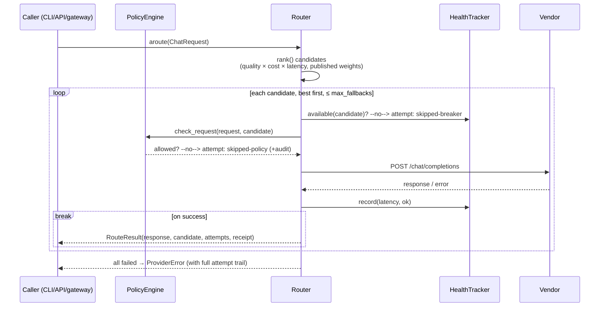

# ZYKO Architecture

How one request flows through the stack, why every decision is verifiable,
and how the pieces stay platform-portable (Linux · Windows · macOS · Android · Termux).

```
┌─────────────────────────────────────────────────────────────────────┐
│  surfaces:  CLI (zyko …)   ·   HTTP gateway (/v1/chat/completions)  │
│             MCP server (stdio)   ·   Python API (Zyko / Router)     │
└──────────────────────────────┬──────────────────────────────────────┘
                               │
                    ┌──────────▼──────────┐      ┌────────────────┐
                    │   PolicyEngine      │◄─────│  audit log     │
                    │  (Policy-as-Code)   │      │  budget/state  │
                    └──────────┬──────────┘      └────────────────┘
                               │ every call, pre-flight
                    ┌──────────▼──────────┐      ┌────────────────┐
                    │   Router            │◄─────│ QualityLedger  │
                    │  rank → fallback    │      │ (EWMA quality) │
                    └──────────┬──────────┘      └────────────────┘
                               │
          ┌────────────┬───────┴──────┬─────────────┬────────────┐
          ▼            ▼              ▼             ▼            ▼
      OpenAI     Anthropic        Google        Ollama      Groq / Mistral
      compat     provider         Gemini        (keyless)   DeepSeek / OpenRouter
          └────────────┴──────────────┴─────────────┴────────────┘
                               │
                    ┌──────────▼──────────┐
                    │  kernel (token est, │   pure Python by default
                    │  similarity, top-k) │   optional Rust accelerator (PyO3)
                    └─────────────────────┘
```

## Layers

| Layer | Package | Responsibility |
|---|---|---|
| Surfaces | `zyko.cli`, `zyko.gateway`, `zyko.mcp.server`, `zyko.client` | humans, HTTP clients, MCP hosts, Python callers |
| Governance | `zyko.policy.engine` | Policy-as-Code: allow/deny, redaction, budget, rate limits, audit |
| Routing | `zyko.router.engine`, `router.health`, `router.quality` | scoring, fallbacks, circuit breaker, reproducible quality |
| Providers | `zyko.providers.*` | vendor dialects → one neutral protocol |
| Agents | `zyko.agents.*` | YAML-defined tool loops (builtin + MCP tools) |
| Kernel | `zyko.kernel` | token estimates & math — pure Python, optional Rust (graceful degradation) |
| Platform | `zyko.platform.*` | OS detection + paths (XDG / `~/Library` / `%APPDATA%` / Termux) |

## Request lifecycle (non-streaming)



Streaming uses the same pipeline with one rule: **fallback only before the
first token** — once a vendor has emitted a token, switching would corrupt
the stream, so a mid-stream vendor failure surfaces honestly instead of
silently stitching two vendors together.

## The receipt — verifiable by construction

Every `RouteResult.receipt` carries:

- `chosen` — the winning `"provider/model"`
- `attempts` — the complete ordered trail (`chosen` / `failed` /
  `skipped-breaker` / `skipped-policy` with reasons)
- score breakdown per candidate: quality, cost, latency, each normalised
  0–1, plus the **published weights** for the active strategy
- token + cost accounting with an explicit `estimated: true | false` flag —
  vendor-reported usage is never silently blended with estimates

Because the board snapshot (prices, latencies, ledger EWMA) and the weights
are in the receipt, any decision can be **re-verified offline** — no vendor
call, no trust in a marketing table. `zyko route --explain` replays it.

## Quality is measured, not claimed

- `QualityLedger` keeps an EWMA of real outcomes per model
  (`quality_ledger.json`, auditable, garbage-input tolerant).
- `zyko bench` runs reproducible benchmark suites with **fixed seeds** and
  objective correctors; results land in `benchmarks/results/` with a JSON
  schema. Marketing quality tables are deliberately not an input.

## Governance is code, applied to every call

`PolicyEngine.check_request` runs **before every candidate attempt** —
provider/model allow-deny, tool allow-deny, deterministic PII redaction
(emails, phones, IPs, cards), local rate limits, daily USD budget. Denials
and redactions are written to the audit log; `zyko cost` reports spend,
denied-by-rule and redaction events from that single log. Malformed policy
sections degrade to schema warnings, never crashes.

## Platform portability

- **Pure-Python core**: only `httpx` + `PyYAML`; nothing mandatory to compile.
- **Rust kernel** (`rust/zyko-kernel`, PyO3): optional accelerator for token
  estimation / similarity; when absent (Android, Termux, exotic wheels) the
  Python implementation is used automatically — same results, no failure mode.
- **Paths**: `ZYKO_*` env override → XDG (Linux) → `~/Library` (macOS) →
  `%APPDATA%` (Windows) → Termux-aware layout, with a first-run marker.
- **Encodings**: output streams reconfigured with `errors="replace"` at CLI
  startup (Windows cp1252 safe); broken pipes exit POSIX-141 cleanly.

## Extension points

- **New provider**: subclass `BaseProvider`, decorate with `@register`,
  implement `acomplete` / `astream` / `catalog` — discovery, health,
  scoring and policy gating come free.
- **New tool**: builtin tools or MCP servers (YAML `mcp:` block) —
  the policy engine gates both identically.
- **New strategy**: `STRATEGY_WEIGHTS` in `router/engine.py`; receipts
  automatically expose the new weights.
